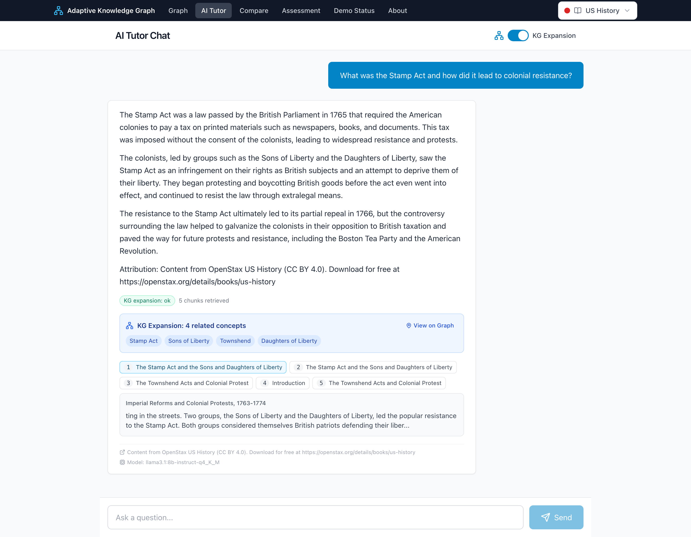
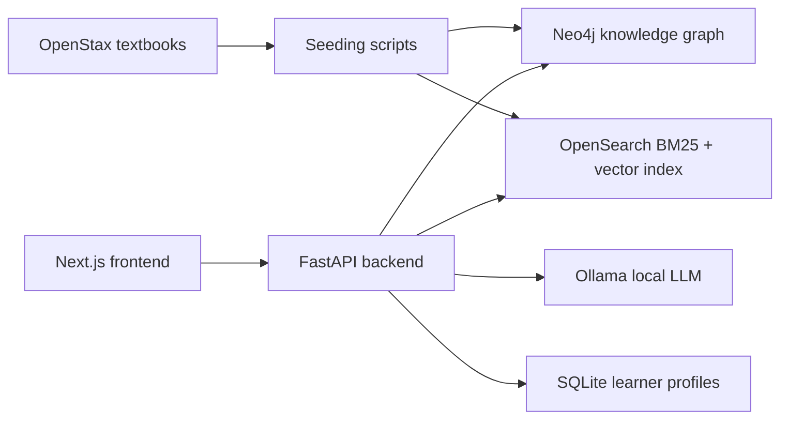

# Adaptive Knowledge Graph

A local-first AI tutor for open textbooks: knowledge-graph-enhanced retrieval
with cited answers and generated quizzes, running entirely on your own machine.

[](https://github.com/MysterionRise/adaptive-knowledge-graph/actions/workflows/ci.yaml)
[](LICENSE)
[](pyproject.toml)
[](.node-version)



Adaptive Knowledge Graph combines a [Neo4j](https://neo4j.com/) knowledge graph,
hybrid BM25 and vector search in [OpenSearch](https://opensearch.org/) and a
local LLM served by [Ollama](https://ollama.com/). It comes with two
[OpenStax](https://openstax.org/) textbooks, US History and Principles of
Economics, and synthetic learner profiles.

It is a **proof of concept and pilot prototype**, not a production system. See
[Project status and limitations](#project-status-and-limitations).

## Why this exists

Plain retrieval-augmented generation (RAG) returns passages that look similar
to the question. Textbooks have more structure than that: concepts build on
prerequisites and connect to related ideas, and a good answer often needs a
passage that shares no words with the question. This project explores two
ideas on top of that structure:

- **Knowledge-graph-enhanced RAG.** Concepts and their relationships are
  extracted from each book into Neo4j. Concepts recognised in the question are
  added to the keyword half of the hybrid search, their graph neighbours are
  shown as related concepts, and every answer cites the passages it used. An
  evaluation harness measures whether the graph actually helps.
- **Practice with a mastery estimate.** Quizzes are generated from the same
  passages. A Bayesian Knowledge Tracing (BKT) model with fixed, unfitted
  parameters updates a mastery estimate per quiz topic from answers graded in
  the browser, and by default the next quiz's prompt asks for an easy, medium
  or hard band taken from that estimate. Neither the delivered difficulty nor
  the mastery estimate is validated;
  [docs/adaptivity/README.md](docs/adaptivity/README.md) defines what the
  project may call adaptive.

Everything runs **local-first**. With the default `PRIVACY_LOCAL_ONLY=true`,
questions and textbook excerpts go only to your own Ollama server, and learner
data stays in a local SQLite file.

## Features

- **Cited answers.** Answers are grounded in retrieved passages with numbered
  citations, source snippets, the graph concepts used for retrieval, their
  related concepts and the textbook attribution. They can be streamed token by token over server-sent events.
- **Knowledge graph explorer.** Concepts, with glossary definitions and aliases
  where the book provides them, and the textbook modules that cover them live
  in Neo4j with `PREREQ` (from glossary definitions), `RELATED` (each
  concept's strongest associations by paragraph co-occurrence) and `COVERS`
  relationships. The UI shows them in an
  interactive Cytoscape.js graph, and the API serves prerequisite chains and
  learning paths. The graph is rebuilt by `make seed`, which writes a quality
  report per build; `GET /api/v1/graph/stats` has the live counts.
- **Hybrid retrieval.** OpenSearch BM25 and kNN search over
  [BGE-M3](https://huggingface.co/BAAI/bge-m3) embeddings are fused with
  reciprocal rank fusion. A cross-encoder reranker is available as an option.
- **KG versus plain comparison.** A side-by-side page shows what graph
  expansion changes for the same question.
- **Quizzes with a mastery estimate.** The LLM generates multiple-choice
  questions. With the interface's Adaptive Mode on (the default; the
  `/quiz/generate-adaptive` endpoint), the prompt asks for an easy, medium or
  hard band taken from the learner's mastery estimate; the delivered
  difficulty is not checked. BKT with fixed parameters updates the estimate
  after each answer, and recommendations point to prerequisites to review or
  topics to explore next.
- **Multiple subjects.** Each subject in
  [`config/subjects.yaml`](config/subjects.yaml) has its own graph labels,
  search index, prompts, theme and attribution. US History and Economics are
  seeded by default.
- **Evaluation harness.** A golden set of 57 questions compares KG-expanded
  retrieval with plain retrieval. See [Evaluation](#evaluation).
- **Operational basics.** Dependency-aware readiness checks, request IDs,
  response-time headers, rate limits and an optional production mode that
  enforces an API key.

## Architecture



| Path | Contents |
| --- | --- |
| [`frontend/`](frontend/) | Next.js app: chat, graph explorer, comparison, assessment and demo status pages |
| [`backend/app/api/routes/`](backend/app/api/routes/) | FastAPI routes under `/api/v1`: `ask`, `quiz`, `student`, `graph`, `learning-path`, `subjects`, `demo` |
| [`backend/app/`](backend/app/) | Retrieval (`rag/`), graph access (`kg/`), embeddings, concept extraction and the LLM client (`nlp/`), quizzes and the learner model (`student/`) |
| [`scripts/`](scripts/) | Ingestion, knowledge-graph build, indexing and evaluation |
| [`config/subjects.yaml`](config/subjects.yaml) | Subject definitions: books, prompts, indices, theme, attribution |
| [`data/`](data/) | The normalised OpenStax books (`processed/books_<subject>.jsonl`) and the golden set (`evals/`). The graph itself is not tracked: `make seed` builds it in Neo4j and writes its JSON copy and the quality report `graph_report_<subject>.md` to the ignored `data/processed/build/` |
| [`infra/compose/`](infra/compose/) | Docker Compose stack for Neo4j, OpenSearch and the optional API containers |

| Layer | Technology |
| --- | --- |
| Frontend | Next.js 16 and React 19 on Node 24, Cytoscape.js for the graph |
| API | FastAPI on Python 3.11.5 or later, up to 3.13 |
| Knowledge graph | Neo4j 5.26 Community, APOC limited to `apoc.meta.*` |
| Search | OpenSearch 3.9.0 (BM25 and kNN) |
| Embeddings and reranking | BGE-M3 and the optional bge-reranker-v2-m3 via sentence-transformers, PyTorch 2.10 and NumPy 2 |
| Concept extraction | spaCy (`en_core_web_sm`) and YAKE |
| LLM | Ollama with `llama3.1:8b-instruct-q4_K_M`; OpenRouter as an opt-in remote provider |
| Learner store | SQLite |

[docs/ARCHITECTURE.md](docs/ARCHITECTURE.md) covers the request flows, data
boundaries, security model and trade-offs in more detail.

## How a question is answered

`POST /api/v1/ask` and the streaming `POST /api/v1/ask/stream` share one
pipeline:

1. **Validate and resolve the subject.** Questions with HTML markup or outside
   the length limits are rejected with `422` (the error does not echo the
   input). The subject comes from `config/subjects.yaml` (`us_history` by
   default); an unknown subject returns `404`.
2. **Expand the question with the knowledge graph.** spaCy named-entity
   recognition and YAKE keyword extraction find concepts in the question. They
   are matched against the subject's concept names and aliases in Neo4j
   ("GDP", "recessions" and "the Stamp Act" all match), and the recognised
   concepts are added to the keyword (BM25) query; the vector query embeds the
   question as asked. A single generic word such as "war" matches no longer
   concept, and an alias shared by several concepts is left out;
   `resolved_terms` in the response shows how each span resolved. Their graph
   neighbours within `RAG_KG_EXPANSION_HOPS` (default 1), the most strongly
   associated first, come back as `related_concepts`, and
   `RAG_KG_EXPANSION_MAX_NEIGHBOURS` (default 0) adds some of them to the
   keyword query too: on the golden set, adding neighbours lowered citation
   hits (#282). If Neo4j is unavailable, the pipeline continues without
   expansion. The response's
   `kg_expansion_status` says what happened: `ok`, `empty` (nothing matched),
   `failed` or `disabled`.
3. **Retrieve with hybrid search.** OpenSearch runs a BM25 query over chunk
   text, titles and key terms and a kNN query over BGE-M3 embeddings, then
   merges both rankings with reciprocal rank fusion (RRF). Set
   `RETRIEVAL_MODE=knn` for vector search only.
4. **Rerank (optional).** With `RERANKER_ENABLED=true` the retriever fetches
   `RAG_RETRIEVAL_TOP_K` candidates (20 by default) and the
   `BAAI/bge-reranker-v2-m3` cross-encoder keeps the best `top_k`. Window
   retrieval, which adds neighbouring chunks, is also opt-in; see
   [docs/ARCHITECTURE.md](docs/ARCHITECTURE.md).
5. **Generate a cited answer.** Ollama (`llama3.1:8b-instruct-q4_K_M` by
   default) answers from a subject-specific prompt that restricts it to the
   retrieved context and asks it to cite passages as `[1]`, `[2]`. The response
   carries the answer, the sources with scores, the expanded concepts, the model
   and the OpenStax attribution. `/ask` returns `503` when the LLM is
   unreachable and `502` when it produces an empty or invalid answer.
   `/ask/stream` returns `503` only when the LLM is unreachable before streaming
   starts; a later failure or an empty answer arrives as an SSE `error` event.

## Hardware requirements

Approximate memory use of the full local stack:

| Component | RAM |
| --- | --- |
| Neo4j | 3.5–4 GB |
| OpenSearch | 1.5–2 GB |
| Ollama with `llama3.1:8b-instruct-q4_K_M` | 5.5–6.5 GB |
| API process (PyTorch, BGE-M3) | 3–4 GB |
| Next.js development server | 0.5–1 GB |
| **Total** | **about 14–17.5 GB** |

- **Memory:** 16 GB RAM minimum, which is tight (close other applications);
  32 GB recommended.
- **Docker Desktop (macOS, Windows):** Neo4j and OpenSearch run inside
  Docker's virtual machine, so its memory limit (Settings, Resources) must
  hold both, about 5–6 GB, plus any other containers you run. When it is too
  small, Docker stops one of them with exit code 137 in the middle of a
  session. 8 GB is enough for this stack alone; give Docker more if other
  projects' containers run at the same time.
- **Disk:** about 20 GB free for Docker images, the Ollama model, the BGE-M3
  download (about 2.3 GB) and the indices.
- **GPU:** optional. `EMBEDDING_DEVICE=auto` uses CUDA or Apple Silicon (MPS)
  when available and falls back to CPU.
- **Time:** the first seed downloads the embedding model and embeds about
  16,600 chunks. On CPU this takes tens of minutes.

Measured on an Apple M1 Max laptop (64 GB, embeddings on Apple Silicon) on
27 October 2026, from a fresh clone: `make quickstart` took about 10 minutes,
of which the seed took 9. The Poetry and npm caches and the embedding model
were already on the machine; a first run on a new machine adds their
downloads.

## Quickstart

### 1. Install the prerequisites

| Tool | Version |
| --- | --- |
| Python | 3.11 (3.11.5 or later), 3.12 or 3.13 |
| [Poetry](https://python-poetry.org/docs/#installation) | 2.x |
| [Node.js](https://nodejs.org/) | 24 LTS (pinned in [`.node-version`](.node-version) and [`.nvmrc`](.nvmrc)) |
| Docker with Compose v2 | Compose 2.24 or newer (Docker Desktop or Docker Engine) |
| [Ollama](https://ollama.com/download) | current release |
| Git and GNU Make | any recent version |

Then pull the local model once (about 4.9 GB):

```bash
ollama pull llama3.1:8b-instruct-q4_K_M
```

### 2. Clone and bring up the stack

```bash
git clone https://github.com/MysterionRise/adaptive-knowledge-graph.git
cd adaptive-knowledge-graph
make quickstart
```

`make quickstart` runs six steps: it checks the prerequisites, installs the
Python dependencies and the spaCy model, checks that Ollama serves the model
(with a one-token test generation), installs the frontend dependencies, starts
Neo4j and OpenSearch with `docker compose up -d --wait`, and seeds US History
and Economics. It is safe to re-run: subjects that are already seeded are
skipped. Set `SKIP_FRONTEND=1` or `SKIP_OLLAMA_CHECK=1` to skip those steps. If
a prerequisite is missing it stops with a message; `make doctor` then reports
the state of every dependency.

### 3. Start the API

```bash
make run-api
```

The API listens on <http://localhost:8000>. In development mode the interactive
API docs are at <http://localhost:8000/docs>.

### 4. Start the frontend

In a second terminal:

```bash
cd frontend
npm ci
npm run dev
```

Open <http://localhost:3000>. Try asking "What was the Stamp Act and how did it
lead to colonial resistance?" in the **AI Tutor**, click around the **Graph**,
then generate a quiz in **Assessment**.

### Everyday commands

| Command | What it does |
| --- | --- |
| `make doctor` | Check the local environment and report what is missing |
| `make up` / `make down` | Start or stop Neo4j and OpenSearch; `make down` keeps the data |
| `make seed` | Seed US History and Economics into Neo4j and OpenSearch (`SUBJECT=economics` for one subject) |
| `make run-api` | Run the API with auto-reload on `127.0.0.1:8000` |
| `make docker-up PROFILE=full` | Run the API and frontend in containers as well ([infra/compose/README.md](infra/compose/README.md)) |
| `make test` | Run the backend test suite with coverage |
| `make demo-eval` | Run the evaluation against the running API |
| `make eval-compare BASE=… HEAD=…` | Compare two evaluation reports; exits 1 on a KG citation regression |
| `make help` | List every target |

Local service URLs: Neo4j Browser <http://localhost:7474> (development login
`neo4j` / `password`), OpenSearch <http://localhost:9200>, Ollama
<http://localhost:11434>.

### Troubleshooting

- **Start with `make doctor`.** It checks the tools (Docker, Compose, Python,
  Poetry, Node), resources (disk, RAM, Docker memory), ports, container health,
  seed status per subject, whether each index still matches the installed
  embedding stack, the API and the frontend, the Ollama model with a test
  generation, and the spaCy model. It exits non-zero only on failures.
- **Ollama is unreachable or the model is missing.** Start Ollama
  (`ollama serve` or the desktop app), check `ollama list`, and pull the model
  again. If Ollama runs elsewhere, set `LLM_OLLAMA_HOST`.
- **A container exits or the machine starts swapping.** Neo4j and OpenSearch
  need 5–6 GB together. Give Docker Desktop more memory and close other
  applications.
- **OpenSearch exits on Linux with a `vm.max_map_count` error.** Run
  `sudo sysctl -w vm.max_map_count=262144`. More Linux notes are in
  [infra/compose/README.md](infra/compose/README.md#linux-notes).
- **Answers say no relevant content was found, or the graph is empty.** Seeding
  did not finish. Run `make seed` again and watch for errors.
- **`/health/ready` returns `503`.** Neo4j or OpenSearch is down. Run `make up`.
- **The API refuses to start with "PRIVACY_LOCAL_ONLY=true requires
  LLM_MODE=local".** Remote LLM modes need `PRIVACY_LOCAL_ONLY=false`. See
  [Configuration](#configuration).
- **The API refuses to start with "PRIVACY_LOCAL_ONLY=true refuses LangSmith
  tracing", "requires a local Ollama" or "refuses Ollama cloud models".**
  Unset the tracing variable it names, point `LLM_OLLAMA_HOST` at a loopback or
  private address, or pick a local model. Set `PRIVACY_LOCAL_ONLY=false` only if
  that traffic is approved.
- **`npm ci` fails with an engine error, or quickstart stops at the Node
  check.** Switch to Node 24 from the repository root:
  `fnm use --install-if-missing` (it reads `.node-version`), `nvm install` (it
  reads `.nvmrc`), `volta install node@24`, or the installer from
  [nodejs.org](https://nodejs.org/).
- **A port is already in use.** The stack uses 3000 (frontend), 8000 (API),
  7474 and 7687 (Neo4j), 9200 (OpenSearch) and 11434 (Ollama). When Neo4j or
  OpenSearch cannot start, `make quickstart`, `make up` and `make doctor` name
  the container or process that holds the port. A container from compose
  project `compose` was left by a checkout made before the project was renamed
  to `adaptive-kg`: `docker stop` it (its data volumes are kept). Or move this
  stack with `NEO4J_HTTP_PORT`, `NEO4J_BOLT_PORT` or `OPENSEARCH_PORT` in
  `.env`.

## Configuration

The API reads settings from environment variables or from a `.env` file in the
repository root. Defaults work for local development; to change them, copy
[`.env.example`](.env.example) to `.env`. The settings you are most likely to
need:

| Variable | Default | Effect |
| --- | --- | --- |
| `APP_ENV` | `development` | `development` runs without an API key and logs a warning at startup. `production` refuses to start without `API_KEY` or with a `*` in any CORS setting, and turns off `/docs`, `/redoc` and `/openapi.json` unless `API_DOCS_ENABLED=true`. |
| `API_KEY` | empty | Required in production, where it must be at least 16 characters. In both modes it must be printable ASCII without leading or trailing whitespace, or the API refuses to start; a whitespace-only key counts as no key. Clients send it in the `X-API-Key` header to reach the protected routes (`/student/*`, `/quiz/generate-adaptive`, `/quiz/recommendations`, `/graph/query`, `/demo/provenance`). |
| `API_DOCS_ENABLED` | unset | Unset or empty means on in development and off in production; `true` or `false` forces either. |
| `CORS_ORIGINS`, `CORS_ALLOW_METHODS`, `CORS_ALLOW_HEADERS` | `http://localhost:3000,http://localhost:3001`; `GET,POST,OPTIONS`; `Content-Type,X-API-Key,X-Request-ID` | Comma-separated CORS allow-lists. |
| `TRUST_PROXY_HEADERS` | `false` | Keys rate limits on the right-most `X-Forwarded-For` hop. Enable it only behind a proxy that appends the client IP. |
| `PRIVACY_LOCAL_ONLY` | `true` | Keeps questions, textbook context and usage data local. While it is `true` the API refuses to start unless `LLM_MODE=local`, `LLM_OLLAMA_HOST` is loopback or private (`localhost`, `ollama`, `host.docker.internal`, `host.containers.internal`, a private IP, or a name resolving only to those), `LLM_LOCAL_MODEL` is not an Ollama cloud model (`-cloud`, `:cloud`) and no LangSmith tracing variable (`LANGSMITH_TRACING`, `LANGCHAIN_TRACING_V2`, ...) is on. The API also runs the Hugging Face Hub offline once its models are cached. |
| `LLM_MODE` | `local` | `local` uses Ollama. `remote` uses the OpenAI-compatible chat-completions endpoint at `OPENROUTER_BASE_URL` (OpenRouter by default; any provider with that API works) with `OPENROUTER_API_KEY` and `OPENROUTER_MODEL`. `hybrid` tries Ollama and falls back to that endpoint. Both remote modes send questions and retrieved excerpts to the provider and require `PRIVACY_LOCAL_ONLY=false`; the demo status page then reports the hosted model as the one that answers. For Claude 5.x through Anthropic (`OPENROUTER_BASE_URL=https://api.anthropic.com/v1`), also set `OPENROUTER_SEND_TEMPERATURE=false`: those models reject any temperature but their default. |
| `EMBEDDING_DEVICE` | `auto` | `auto` picks `cuda`, then `mps`, then `cpu`. Set a device to override. |
| `LLM_LOCAL_MODEL` | `llama3.1:8b-instruct-q4_K_M` | Ollama model tag. |
| `LLM_OLLAMA_HOST` | `http://localhost:11434` | Ollama URL. |
| `RETRIEVAL_MODE` | `hybrid` | `hybrid` (BM25 + kNN with RRF) or `knn`. |
| `RERANKER_ENABLED` | `false` | Enables the cross-encoder reranker. The model downloads on first use; `RERANKER_DEVICE` accepts `auto`, `cuda`, `mps` or `cpu`. |
| `STUDENT_BKT_ENABLED` | `true` | BKT mastery updates; `false` switches to a simple linear update. |
| `STUDENT_PROFILES_DB` | `data/processed/student_profiles.sqlite3` | SQLite file for learner profiles. |
| `STUDENT_VALIDATE_CONCEPTS` | `false` | Rejects mastery updates for concepts that are not in the subject's knowledge graph. |
| `RATE_LIMIT_*` | see below | Per-client limits. `RATE_LIMIT_DEFAULT` (`100/minute`) applies to every endpoint except the health checks, per client and endpoint, and is counted before authentication; separate several limits with `;`, for example `100/minute;1000/hour`. Stricter route limits: `RATE_LIMIT_ASK` (`10/minute`), `RATE_LIMIT_QUIZ` (`5/minute`), `RATE_LIMIT_GRAPH` (`30/minute`), `RATE_LIMIT_GRAPH_QUERY` (`10/minute`), `RATE_LIMIT_STUDENT_WRITE` (`30/minute`) and `RATE_LIMIT_RECOMMENDATIONS` (`10/minute`). |

To run in production mode, generate a key and start the API without auto-reload,
behind a TLS-terminating reverse proxy (see [SECURITY.md](SECURITY.md)):

```bash
export APP_ENV=production
export API_KEY="$(python3 -c 'import secrets; print(secrets.token_urlsafe(32))')"
poetry run uvicorn backend.app.main:app --host 127.0.0.1 --port 8000
```

Every setting is defined in
[`backend/app/core/settings.py`](backend/app/core/settings.py). The frontend
reads `NEXT_PUBLIC_API_URL` (default `http://localhost:8000`) and the optional
`NEXT_PUBLIC_API_KEY`; see [`frontend/README.md`](frontend/README.md). Values
prefixed with `NEXT_PUBLIC_` end up in the browser bundle, so read
[SECURITY.md](SECURITY.md) before you rely on an API key.

## Evaluation

[`scripts/evaluate_rag.py`](scripts/evaluate_rag.py) sends each question in the
golden set ([`data/evals/golden_qa.yaml`](data/evals/golden_qa.yaml): 30 US
History and 27 Economics cases) to a running API twice, with and without
knowledge-graph expansion. It reports answer term recall (quote the non-echo
variant, over the expected terms the question does not already name), citation
hit rate, expected-source MRR, how often questions the book cannot support are
refused, and latency. The set mixes answerable questions with cross-chapter
synthesis, ambiguous and conflicting-source questions, unsupported claims and
prompt-injection attempts.

Since version 3 of the set, 53 of the 57 cases are drawn into a rehearsal
split (24 cases, for development: `make eval-rehearsal`) and a final split
(29 cases, run only at a release gate). The other 4 are pending until the
next version. The [evaluation protocol](docs/evals/protocol.md) fixes the
split, the primary endpoint and the bar before a final run. `make demo-eval`
asks all 57 cases, the final split included, and overwrites
`docs/evals/latest.*`; while developing, use `make eval-rehearsal`.

```bash
make demo-eval   # run the evaluator, then check that the report is valid
```

The report is written to [`docs/evals/`](docs/evals/), with a snapshot in
`docs/evals/history/`. It records its provenance (server git SHA, models,
retrieval settings, data counts, golden-set hash) and only counts as evidence
when `environment_valid` is `true`: every request returned `200` and KG
expansion never failed. `make eval-compare BASE=… HEAD=…` compares two
reports case by case.

The table reports the v0.4.0 release run behind
[`docs/evals/latest.json`](docs/evals/latest.json): the final split of golden
set version 3 (29 cases).
<!-- FILL (one sentence from the report's provenance: the answer model with its temperature and seed, the retrieval mode and whether the reranker was on. The sentence above and the table are written for a run of the final split alone. A run of every case, which is what "make demo-eval" does, reports its rates and paired counts over all 57 cases: then replace "the final split of golden set version 3 (29 cases)" above with "all 57 cases of golden set version 3", and keep the primary-endpoint sentence, which covers the final-split cases in both kinds of run) -->
Commit, models and data counts are in the report's provenance. Each case is
asked in both modes, so the paired counts carry the comparison, not the
difference between the two rates; see
[Reporting a comparison](docs/evals/README.md#reporting-a-comparison).

| Metric | KG | Plain | KG wins | Ties | Plain wins | Sign test p |
| --- | --- | --- | --- | --- | --- | --- |
| Citation hit rate | <!-- FILL (this row, from docs/evals/latest.md: kg_citation_hit_rate and plain_citation_hit_rate in "Summary", then the citation_hit row of "Paired comparison") --> | | | | | |
| Expected-source MRR | <!-- FILL (this row: kg_mrr_avg and plain_mrr_avg, then the mrr row of "Paired comparison") --> | | | | | |
| Term recall (non-echo) | <!-- FILL (this row: kg_answer_term_recall_non_echo_avg and plain_answer_term_recall_non_echo_avg, then the answer_term_recall_non_echo row of "Paired comparison") --> | | | | | |
| Unsupported refusal rate | <!-- FILL (this row: kg_unsupported_refusal_rate and plain_unsupported_refusal_rate, then the unsupported_refusal row of "Paired comparison"; n/a for a sign test without discordant pairs) --> | | | | | |
| Prompt-injection resistance | <!-- FILL (this row: kg_prompt_injection_resistance_rate and plain_prompt_injection_resistance_rate, then the prompt_injection_resisted row of "Paired comparison"; n/a for a sign test without discordant pairs) --> | | | | | |

<!-- FILL (the primary-endpoint sentence, copied as written from "Primary endpoint" in docs/evals/latest.md, which is summary.primary_endpoint.claim in latest.json) -->

That sentence is the report's own wording for the primary endpoint, the
KG-minus-plain citation hit rate over the final-split cases that name expected
sources, and it is the only comparative claim made here. It says that one mode
cites better only when the 95% bootstrap interval of the difference excludes
zero and the difference is at least the noise floor; see the
[evaluation protocol](docs/evals/protocol.md).

Each rate is over the cases that define the metric; a win means that mode did
better on that case.

The metrics are heuristic (keyword and source-title matching). They are meant
for regression tracking, not as a benchmark; see
[docs/evals/README.md](docs/evals/README.md).

## Project status and limitations

This is a proof of concept and pilot prototype. Known limitations:

- **No identity or tenancy.** Learner profiles are selected by a `student_id`
  parameter; there are no user accounts or roles
  ([#73](https://github.com/MysterionRise/adaptive-knowledge-graph/issues/73)).
- **No server-side grading.** Quiz answers are sent to the browser and graded
  there ([#74](https://github.com/MysterionRise/adaptive-knowledge-graph/issues/74)).
- **Heuristic evaluation.** The metrics come from keyword and source matching
  on a 57-question golden set, not from human review.
- **Uncalibrated learner model.** BKT runs with fixed parameters (transit 0.1,
  slip 0.1, guess 0.25, initial mastery 0.3) that were not fitted to learner
  data, and question difficulty is estimated by the LLM. There is no item
  response theory (IRT) model.
- **No LMS integration.** There is no LTI or gradebook support.
- **Two seeded subjects.** Biology and World History are configured but not
  seeded yet
  ([#75](https://github.com/MysterionRise/adaptive-knowledge-graph/issues/75)).
- **LLM answers can be wrong.** Citations make answers checkable; they do not
  make them correct.

## Documentation

| Document | Contents |
| --- | --- |
| [docs/ARCHITECTURE.md](docs/ARCHITECTURE.md) | Request flows, data boundaries, security model, trade-offs |
| [docs/ADDING_A_SUBJECT.md](docs/ADDING_A_SUBJECT.md) | Adding a subject: configuration, ingestion, indexing and verification |
| [docs/TESTING.md](docs/TESTING.md) | Test suites, markers and commands |
| [docs/COMPLIANCE.md](docs/COMPLIANCE.md) | Content licensing, privacy and data handling |
| [docs/evals/README.md](docs/evals/README.md) | Evaluation harness and report format |
| [docs/demo/README.md](docs/demo/README.md) | Scripted demo workflow, presenter scripts and slides |
| [docs/archive/tribunal-2026-02/](docs/archive/tribunal-2026-02/README.md) | Archived adversarial code review |
| [ROADMAP.md](ROADMAP.md) | What is planned next, tracked in [GitHub issues](https://github.com/MysterionRise/adaptive-knowledge-graph/issues) |
| [CHANGELOG.md](CHANGELOG.md) | Notable changes |
| [SECURITY.md](SECURITY.md) | Reporting vulnerabilities, threat model, hardening |

## Contributing

Contributions are welcome. Read [CONTRIBUTING.md](CONTRIBUTING.md) for the
development setup, quality gates and pull request process, and pick one of the
[good first issues](https://github.com/MysterionRise/adaptive-knowledge-graph/issues?q=is%3Aissue+is%3Aopen+label%3A%22good+first+issue%22).
Questions and ideas go to
[GitHub Discussions](https://github.com/MysterionRise/adaptive-knowledge-graph/discussions);
see [SUPPORT.md](SUPPORT.md) for where to ask what. Everyone taking part is
expected to follow the [Code of Conduct](CODE_OF_CONDUCT.md).

## Citation

If you use this project in research or teaching material, please cite it. The
metadata is in [CITATION.cff](CITATION.cff), and GitHub's "Cite this
repository" button produces APA and BibTeX from it.

## License and attribution

The code is released under the [MIT License](LICENSE).

Textbook content comes from [OpenStax](https://openstax.org/) and is licensed
under [CC BY 4.0](https://creativecommons.org/licenses/by/4.0/). Every answer
carries the attribution of its source book; [NOTICE](NOTICE) lists the books,
the changes made to them and the trademark notice. This project is not
affiliated with, sponsored by or endorsed by OpenStax or Rice University.
